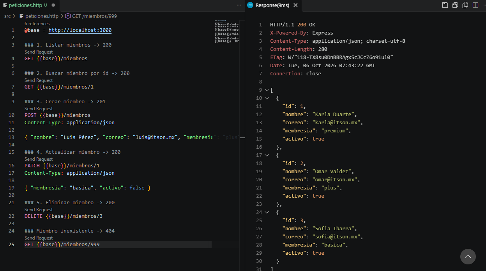
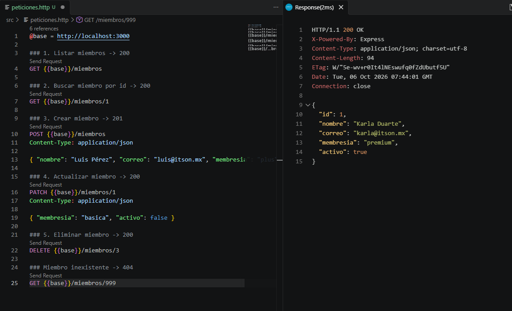
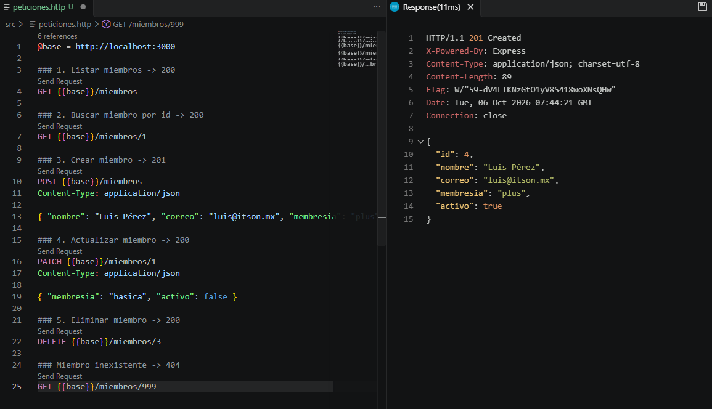
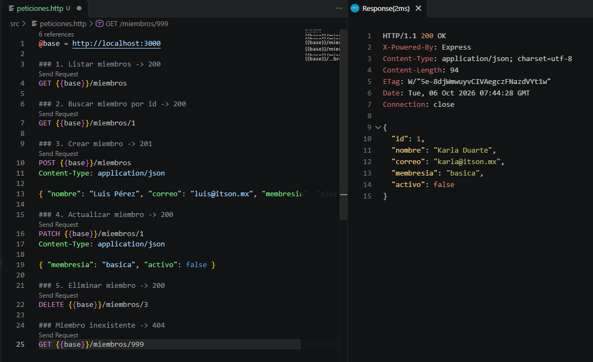
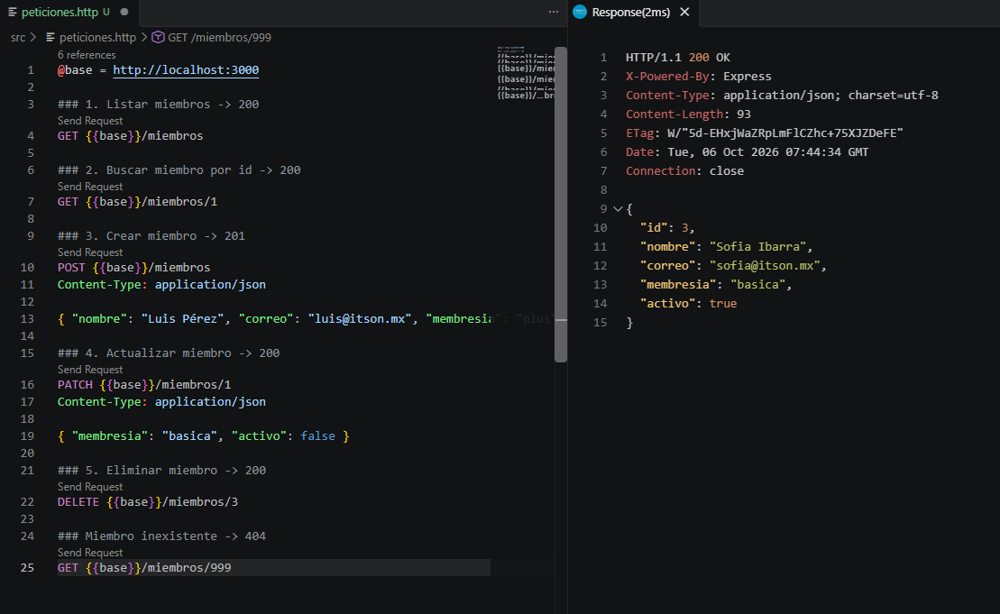

# Práctica 07: Construir el módulo Miembros

Módulo Miembros de la API del gimnasio con NestJS. Repite el mismo patrón de la
Práctica 6 sobre una segunda entidad: Miembro, con listar, buscar, crear, actualizar 
y eliminar. 

## Cómo ejecutarla

```bash
npm install
npm run start:dev
```

## Respuestas

### 1. ¿Por qué la interfaz `MiembroRepository` no menciona Express, NestJS ni memoria?
Porque es el contrato del dominio: solo dice qué operaciones existen sobre los
miembros, no cómo ni dónde se guardan los datos. Así se puede cambiar el almacenamiento 
(memoria, Prisma, MySQL) o el framework sin modificar la interfaz.

### 2. ¿Qué palabra de `MiembroMemoriaRepository` es la que promete cumplir la interfaz?
`implements`. Con ella la clase promete tener todos los métodos de
`MiembroRepository`, y TypeScript marca un error si falta alguno.

### 3. ¿Por qué `MiembrosService` no sabe qué es una petición HTTP?
Porque solo recibe DTOs y datos, y los delega al repositorio. No usa `Request`,
`Response` ni códigos de estado; de eso se encarga el Controller. Por eso el
Service podría reutilizarse con otro tipo de entrada, no solo HTTP.

### 4. ¿Por qué el Service se inyecta sin token en el Controller, y el repositorio sí necesita uno?
El Service es una clase: existe en tiempo de ejecución y es su propio token, así
que Nest la resuelve solo. El repositorio se declara con una interfaz, que
desaparece al compilar a JavaScript, así que se necesita un valor real (el
token `MIEMBRO_REPOSITORY`) como llave, enlazado en el módulo con `useClass` a
la implementación elegida.

### 5. ¿Qué prueba, en los hechos, que agregar Miembros no rompió nada de Inscripciones?
Que las peticiones de Inscripciones responden igual que en la Práctica 6 (201,
409 por cupo lleno, 409 por duplicada y 404) y que el servidor levanta con
ambos controladores registrados. Los módulos no comparten providers ni tokens,
así que no se afectan entre sí.

## Evidencias

### Listar miembros (GET /miembros)


### Buscar miembro por id (GET /miembros/1)


### Crear miembro (POST /miembros)


### Actualizar miembro (PATCH /miembros/1)


### Eliminar miembro (DELETE /miembros/3)
