# Práctica 10: Blindar la API, JWT y OpenAPI

API del gimnasio hecha con NestJS. En la **Parte 1** se blindó el ciclo de vida de la petición (filtro de excepciones, middleware, interceptores y CORS). En la **Parte 2** se agregó autenticación con JWT, un guard global, control de acceso por rol, documentación OpenAPI en `/docs` y la tabla de usuarios en MySQL con Prisma.

## Cómo correrlo

1. Instalar dependencias:
```bash
   npm install
```
2. Aplicar las migraciones, generar el cliente, sembrar los datos y levantar la API:
```bash
   npx prisma migrate deploy
   npx prisma generate
   npx prisma db seed
   npm run start:dev
```

La documentación queda en `http://localhost:3000/docs`.

# Parte 1: blindar la API

## Evidencias

**409 con la nueva forma** (`error`, ruta y marca de tiempo)

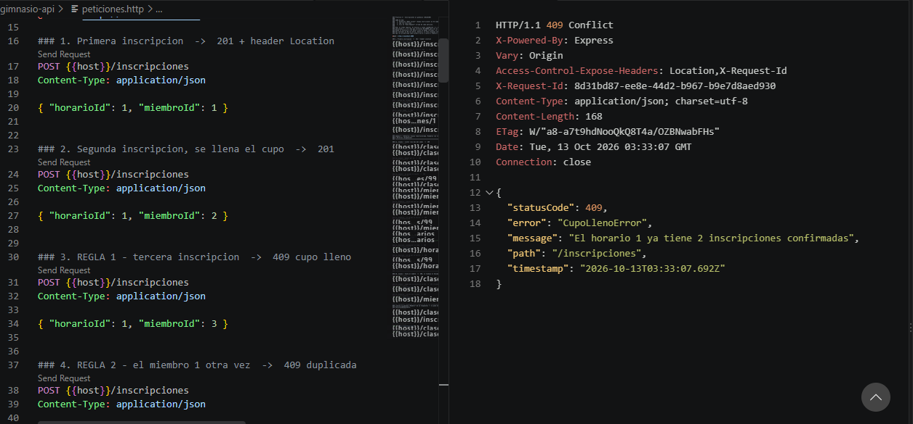

**Respuesta con `X-Request-Id`**


**CORS con el origen permitido** (`http://localhost:5173`)

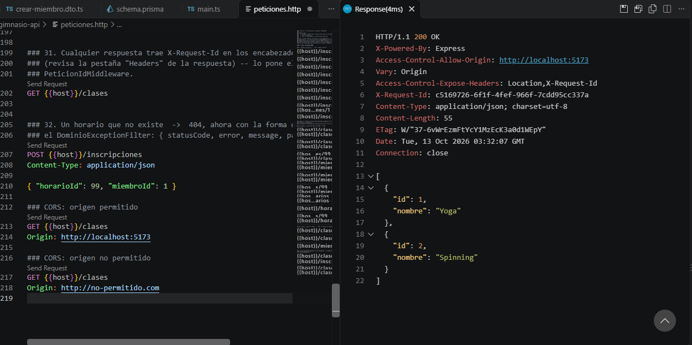

**CORS con el origen no permitido** (`http://nopermitido.com`)

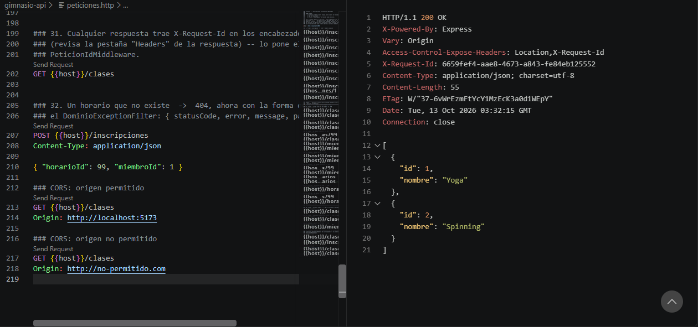

## Respuestas

**¿Por qué el filtro atrapa la clase base y no cada error por separado?**

Porque todos los errores del gimnasio extienden `ErrorDeDominio`, y `@Catch(ErrorDeDominio)` atrapa esa clase y todas sus hijas con un solo filtro. Así el código de traducción vive en un único lugar, y si mañana se agrega un error nuevo que extienda la clase base, el filtro ya lo atrapa sin tocarlo. Con un filtro por error habría que repetir la misma estructura de respuesta en cada uno.

**Al comentar `next()` en el middleware, ¿qué pasa?**

La petición se queda colgada para siempre: el cliente espera sin recibir respuesta y no sale ningún error, porque el middleware nunca le pasó el control al siguiente paso. Al regresar la línea, todo vuelve a funcionar.

**¿Por qué este middleware no podría decidir si un usuario tiene permiso para una ruta?**

Porque el middleware corre antes de que Nest sepa qué controlador y qué método va a atender la petición. Solo ve `req`, `res` y `next` de Express, y no tiene acceso a los metadatos del método (como `@Roles()` o `@Publico()`). Un Guard sí tiene ese contexto de ejecución, por eso la autorización se hace ahí.

**¿Por qué la petición que responde 409 no aparece en el registro de tiempos?**

Porque el interceptor usa `tap`, que solo corre cuando el controlador responde bien. Cuando el Service lanza `CupoLlenoError`, el flujo se salta el `tap` y va directo al filtro. Ese error sí queda registrado, pero por el logger del filtro (`WARN [Dominio]`).

**¿Por qué el sobre rompe a cualquier cliente que ya estuviera usando la API?**

Porque cambia la forma de toda respuesta exitosa: lo que antes era `res[0]` ahora es `res.data[0]`. Cualquier cliente que ya leía la forma anterior deja de funcionar. Por eso se decide antes de que el frontend empiece a consumir la API.

**Si el servidor respondió en los dos casos de CORS, ¿quién bloquea y a quién protege?**

Quien bloquea es el navegador, no el servidor. El servidor responde igual en ambos casos; con un origen no permitido la respuesta no trae `Access-Control-Allow-Origin`, y por eso el navegador no deja que el JavaScript de esa página la lea. Protege al usuario, para que una página maliciosa no use su navegador para leer datos de la API. No protege a la API: un cliente que no es navegador (curl, Postman, REST Client) nunca pasa por CORS.

---

# Parte 2: JWT y OpenAPI

## Evidencias

**401 sin token**

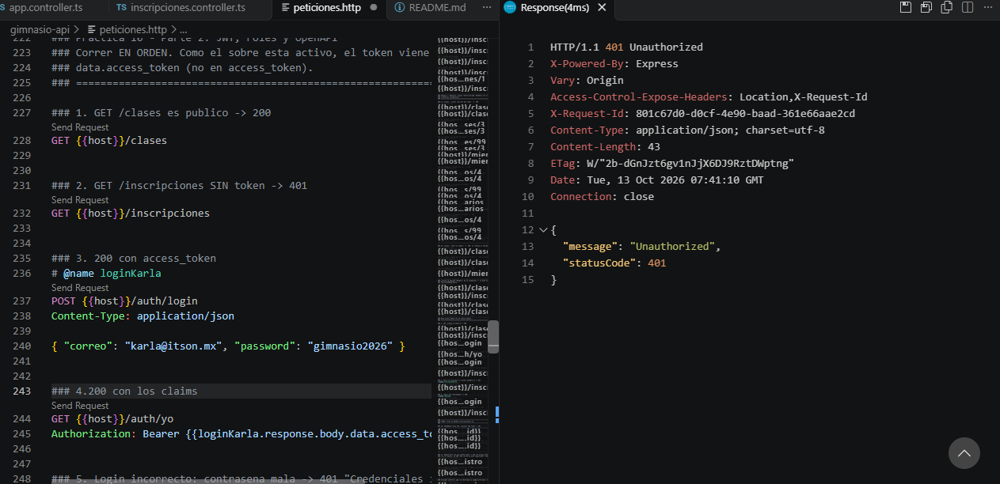

**Inicio de sesión**

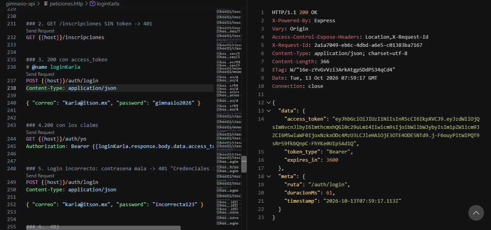

**Datos del token en jwt.io**

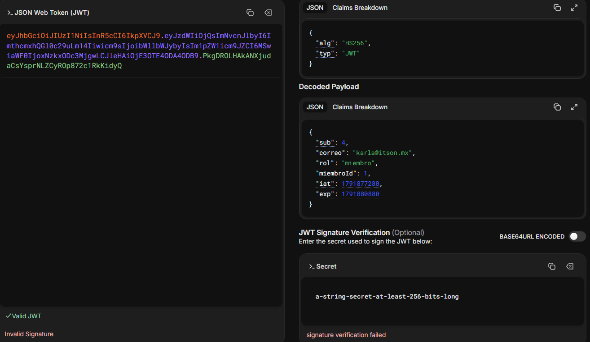

**403: un miembro intenta inscribir a otro**

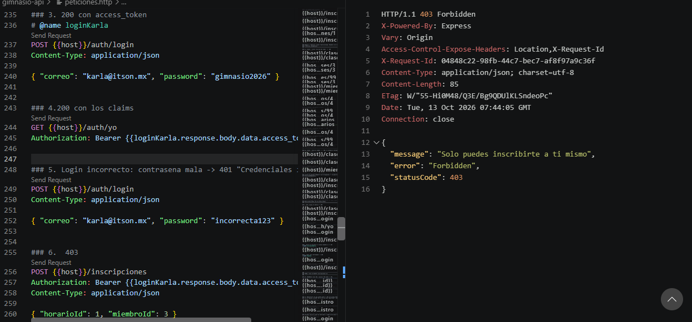

**Documentación en `/docs` con el candado**

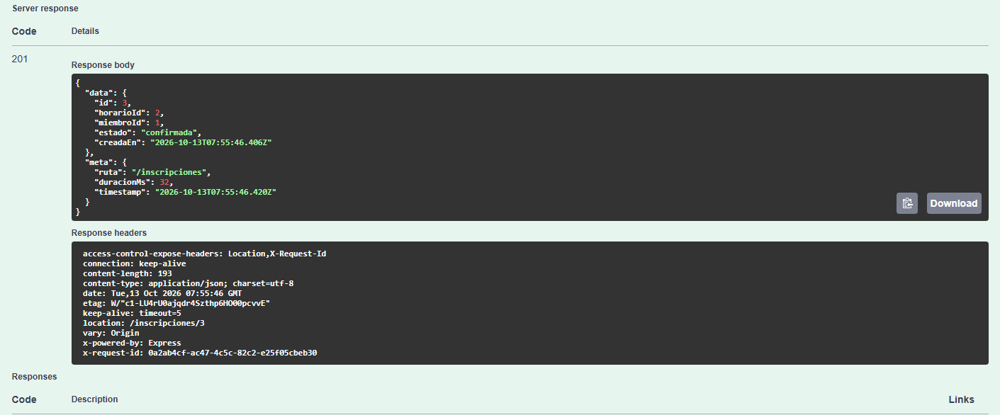

**Carpeta de la migración de usuarios**

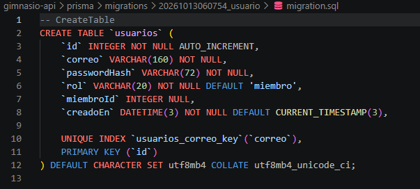

**Inicio de sesión después de reiniciar el servidor**

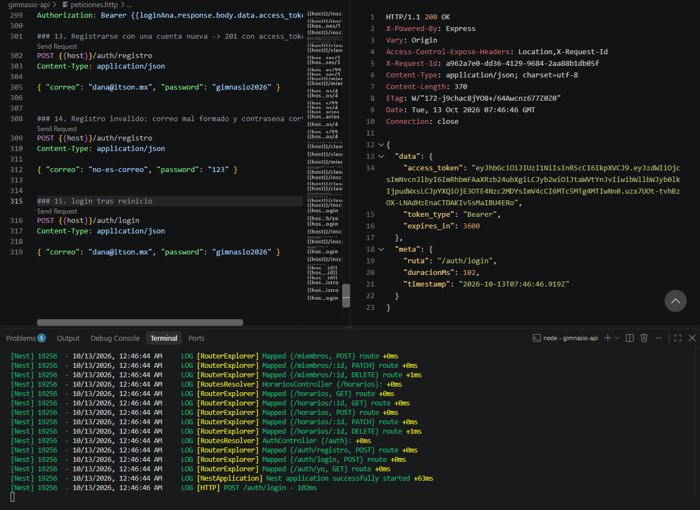

## Respuestas

**¿Por qué el campo se llama `passwordHash` y no `password`?**

Porque lo que se guarda nunca es la contraseña, sino su hash de bcrypt. Con ese nombre es imposible guardar la contraseña en claro por descuido: cualquiera que lea el código ve que ahí va un hash. Si la base de datos se filtra, no se exponen las contraseñas reales.

**¿Por qué los dos errores del inicio de sesión dicen exactamente lo mismo?**

Para no revelar qué correos existen. Si "el correo no existe" y "la contraseña es incorrecta" dieran mensajes distintos, un atacante podría probar correos uno por uno y saber cuáles tienen cuenta. 

**Si el contenido del token se puede leer, ¿qué es lo que protege la firma?**

En jwt.io se lee sin el secreto el encabezado y el payload (`sub`, `correo`, `rol`, `miembroId`, `iat` y `exp`). La firma no protege la confidencialidad, protege la integridad: solo quien tiene `JWT_SECRET` puede firmar un token válido. Si alguien cambia el payload, la firma deja de coincidir y el Guard lo rechaza con 401.

**¿Por qué es más seguro proteger todo por omisión y abrir a mano, que al revés?**

Porque si alguien olvida marcar una ruta con `@Publico()`, la ruta queda cerrada (da 401) y el error se nota enseguida. Al revés, si se olvida proteger una ruta, queda abierta y nadie lo ve.

**¿Cuál es la diferencia entre un 401 y un 403?**

El **401** significa "no sé quién eres": no mandaste token, está vencido o la firma no es válida. El **403** significa "sé quién eres, pero no tienes permiso": el token es válido, pero tu rol o tu identidad no alcanzan para esa acción.

**¿Cuántas líneas del `AuthService` tuvieron que cambiar para pasar de memoria a MySQL? ¿Por qué?**

Ninguna. Solo cambió una línea en `auth.module.ts`: el `useClass`, que pasó de `UsuarioMemoriaRepository` a `UsuarioPrismaRepository`. El `AuthService` depende de la interfaz `UsuarioRepository`, inyectada con el token `USUARIO_REPOSITORY`, así que no sabe si detrás hay un `Map` en memoria o MySQL.

## Explicación del flujo de JWT

1. El cliente manda `POST /auth/login` con su correo y contraseña.
2. El servidor busca al usuario y bcrypt compara la contraseña con el hash guardado.
3. Si coincide, el servidor firma un token con `JWT_SECRET` y lo regresa. El token tiene tres partes: encabezado, payload y firma.
4. El cliente manda el token en `Authorization: Bearer <token>` en cada petición.
5. El Guard verifica la firma; si es válida, deja el payload en `req.user` y el controlador lo lee con `@UsuarioActual()`.
6. Si alguien cambia el payload, la firma ya no coincide y el Guard responde 401.
7. Si no manda token, el Guard responde 401 sin llegar al controlador.

**¿Por qué es importante tomar al usuario de los claims del token y no de un parámetro de la URL o del cuerpo?**

Porque la URL y el cuerpo los controla quien hace la petición, y el token viene firmado por el servidor. Un ejemplo concreto: si la API confiara en `GET /miembros/3/inscripciones`, Karla (miembro 1) podría cambiar el 3 por cualquier otro número y leer las inscripciones de otros miembros. Lo mismo pasaría si confiara en el `miembroId` del cuerpo sin compararlo con el token: Karla podría mandar `{ "miembroId": 3, "horarioId": 1 }` e inscribir a Sofía. El claim que se usa es `miembroId` (junto con `rol` y `sub`), y se compara con el del cuerpo. El cliente no puede falsificarlo porque está dentro del payload firmado con `JWT_SECRET`: si lo cambia, la firma no coincide y el Guard rechaza el token.

---

# Tarea: roles

Solo el entrenador y el administrador pueden cancelar una inscripción (`DELETE /inscripciones/:id`). Se agregó el decorador `@Roles(...)`, que guarda en el método la lista de roles permitidos con `SetMetadata`, y `RolesGuard`, que la lee con el `Reflector` y la compara con el `rol` del token.


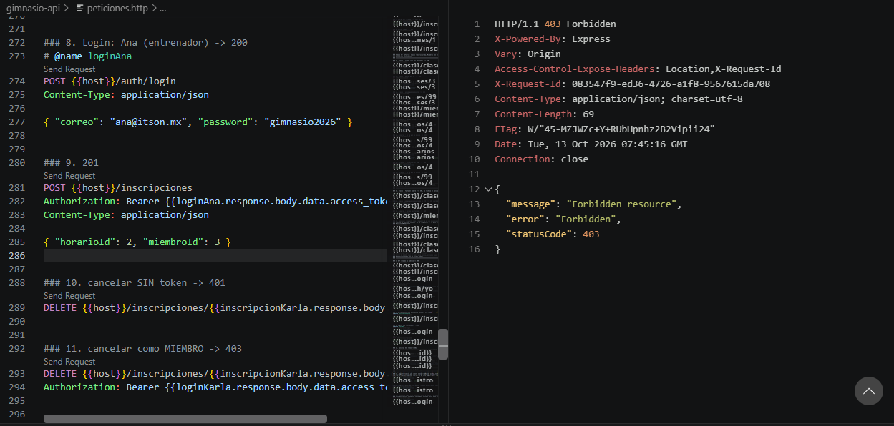

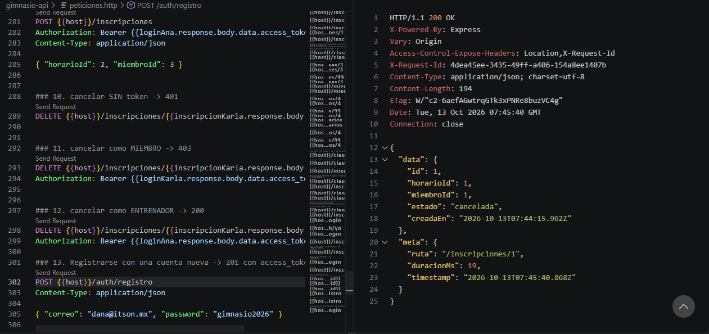