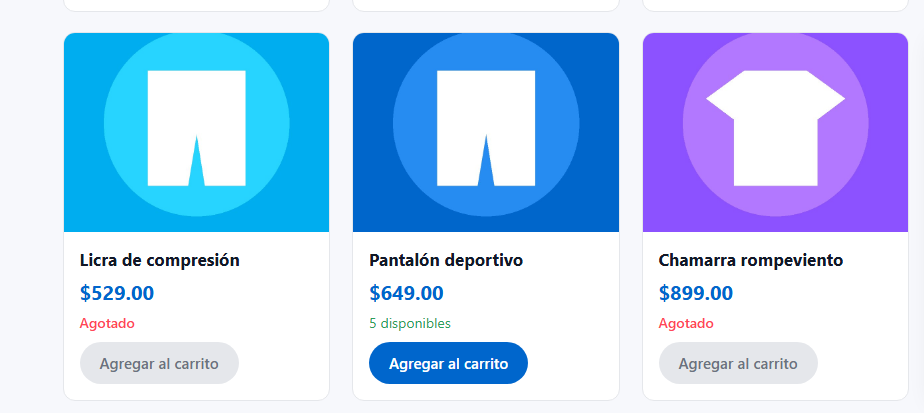
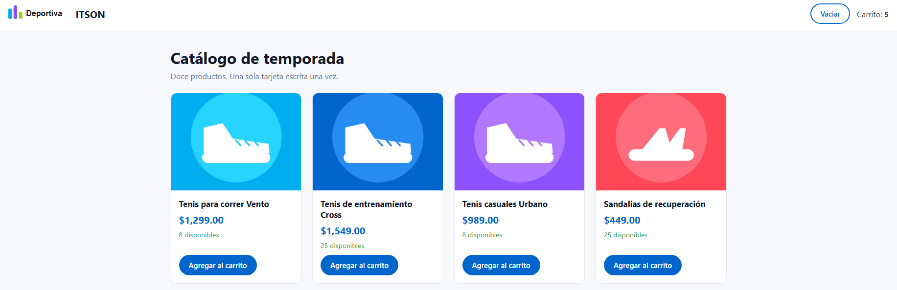

# Práctica 11: Web Components

Componentes reutilizables hechos con el estándar del navegador (Custom Elements y Shadow DOM), sin librerías. Se comprueban las tres partes de su contrato: lo que reciben (atributos y slots), lo que avisan hacia afuera (eventos propios) y lo que nadie más puede tocar (el árbol de sombra).

## Cómo correrlo

```bash
npm install
npm run dev
```

## Ejercicio 1: un botón reutilizable

Componente del botón con su árbol de sombra y sus estilos en un archivo CSS. Recibe la variante y el estado deshabilitado por atributos, y el texto por un hueco (`<slot>`). Se registró con un nombre con guion y se usa en el encabezado.

### Evidencia: el botón 


### Qué pasa al cambiar la variante en el HTML (ajusta)

Al cambiar el atributo `variante` en el HTML (por ejemplo, de `primario` a `secundario`), el botón cambia de aspecto sin tocar el TypeScript. El componente lee ese atributo y el CSS de su árbol de sombra aplica los estilos de la variante correspondiente, así que se personaliza desde el HTML.

### Respuesta

**¿Por qué el nombre de una etiqueta propia debe llevar guion?**

Porque el estándar de HTML exige que los elementos personalizados tengan un guion en el nombre. Ningún elemento nativo lleva guion (`div`, `button`, `p`), ni los que se agreguen en el futuro, así que el guion garantiza que un nombre propio nunca choque con uno que el navegador defina más adelante. También le permite al analizador de HTML distinguir un elemento propio de uno nativo. Si se intenta registrar un nombre sin guion con `customElements.define`, el navegador lanza un error.

## Ejercicio 2: la tarjeta de producto

Componente de la tarjeta que usa por dentro al botón del ejercicio anterior. Recibe el **nombre**, el **precio**, la **imagen** y la **existencia** por atributos. Si la existencia es cero, muestra «Agotado» y deshabilita el botón. Los productos se traen del archivo de datos y se crea una tarjeta por cada uno. Al presionar el botón, la tarjeta emite un evento propio con el identificador, el nombre y el precio, y el contenedor lo escucha una sola vez para actualizar el contador. «Vaciar» lo regresa a cero.

### Evidencia: catálogo con las tarjetas agotadas



### Evidencia: contador después de agregar


