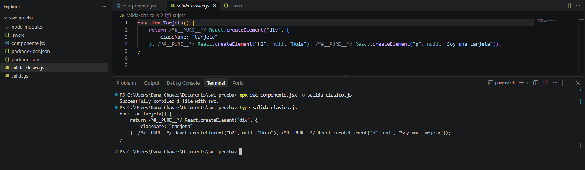
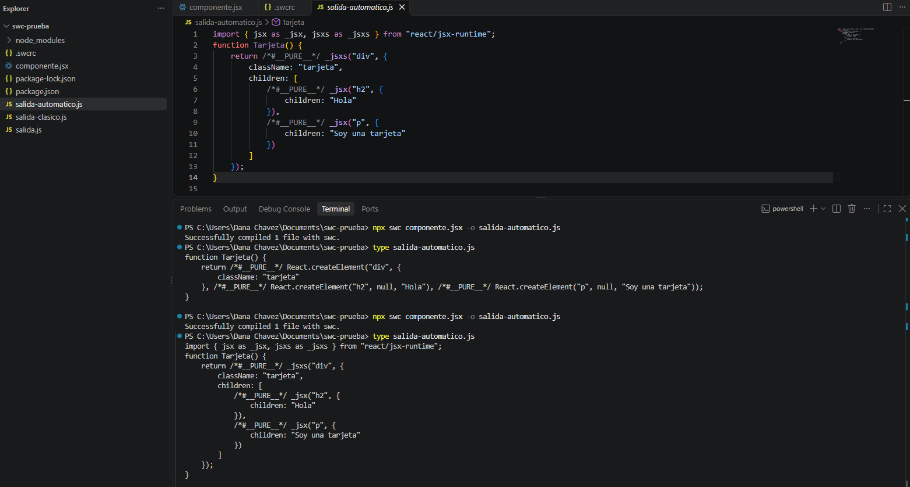
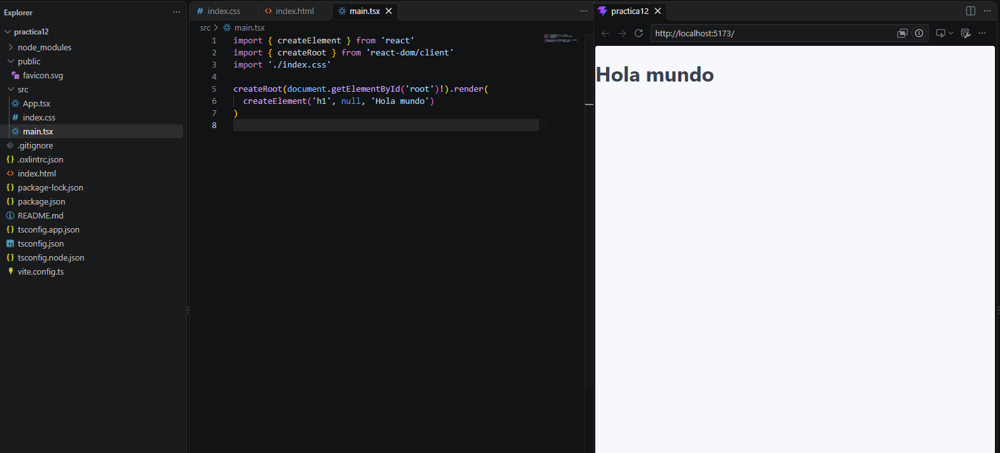
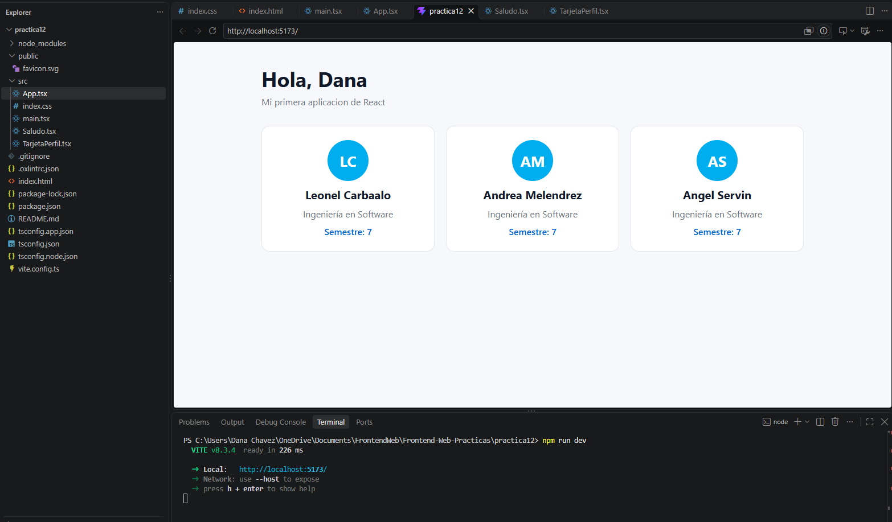
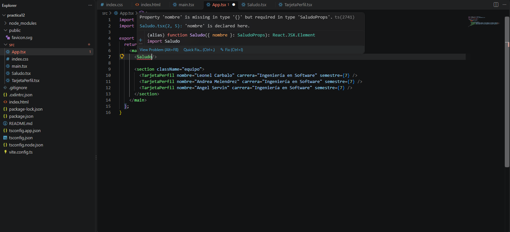

# Práctica 12 – Hola React (Parte 1)

## 1. Qué hace el compilador con el JSX

Se usó SWC en una carpeta aparte (`swc-prueba`) con un componente pequeño en JSX.

**Resultado al compilar sin configuración:**
No mostró ningún error, pero tampoco tradujo el JSX: el archivo `salida.js` se generó vacío. Sin configuración, SWC no sabe que debe transformar JSX, por lo que no produce una salida útil.

**Salida en modo clásico:**

**Salida en modo automático:**

**¿En qué se convirtió cada etiqueta del JSX?**
En llamadas a funciones. En modo clásico, cada etiqueta se volvió un `React.createElement(...)`. En modo automático, se volvió un `_jsx(...)` o `_jsxs(...)`.

**Si React es «sólo una biblioteca», ¿quién traduce el JSX?**
Un compilador, en este caso SWC. React solo trae las funciones; el compilador es quien convierte el JSX en llamadas a ellas.

---

## 2. Proyecto con Vite

Se creó con la plantilla de React y TypeScript, se borraron los estilos y las imágenes de ejemplo y se puso el archivo de estilos.

**Contenedor vacío:** está en `index.html`, es `

`. Lo llena React desde `src/main.tsx`.

---

## 3. «Hola mundo» sin JSX

Título pintado usando solo `createElement`:

**¿Qué hace `createRoot` y qué hace `render`?**
`createRoot` conecta React con un elemento de la página (el `#root`). `render` le dice qué debe dibujar ahí.

---

## 4. El primer componente

Se creó el componente `Saludo`, que recibe `nombre` por props con su interfaz de TypeScript, y se usa desde `App.tsx`. También se creó `TarjetaPerfil`, usado tres veces:

**Error al quitar la prop obligatoria:**

**¿Por qué el nombre de un componente empieza con mayúscula?**
Porque así React distingue un componente de una etiqueta HTML normal: lo que empieza con minúscula (`
`) es HTML, y lo que empieza con mayúscula (`<Saludo>`) es un componente.