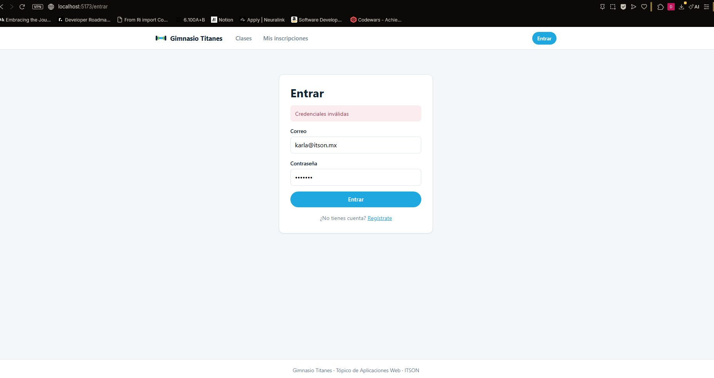
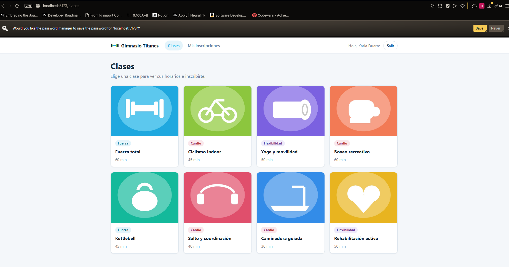
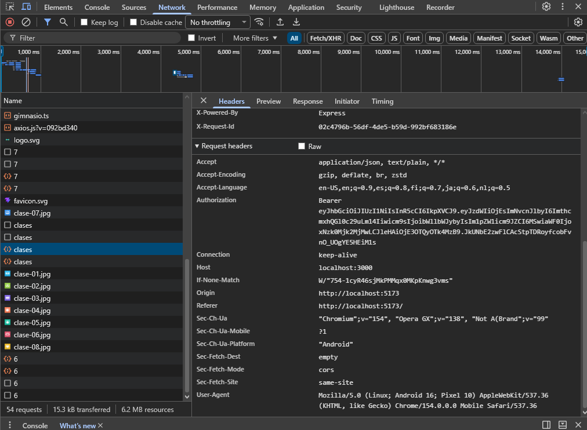
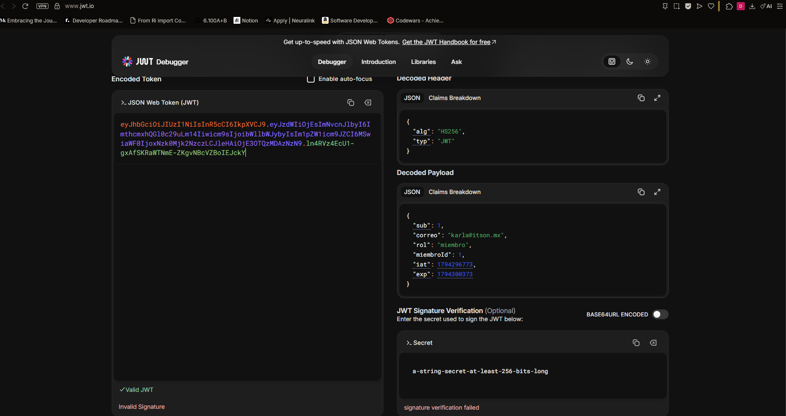
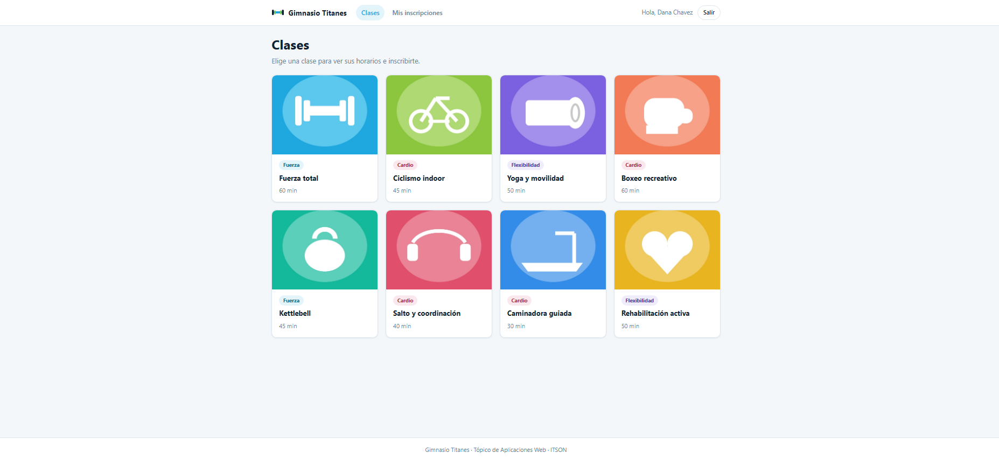

# Práctica 16 – Sesión con contexto, login y token

## Ejercicio 1: el contexto de sesión

**¿Por qué se usa un contexto y no props para la sesión?**
Porque la sesión la necesitan componentes en distintos niveles (encabezado, páginas, formularios). Con props habría que pasarla por todos los componentes intermedios aunque no la usen. Con el contexto, cualquier componente la lee directamente.

**¿Qué pasa si un componente usa la sesión fuera del proveedor?**
No encuentra el contexto (su valor es `null`), así que el hook `useSesion` lanza un error indicando que debe usarse dentro de `<ProveedorSesion>`.

## Ejercicio 2: entrar y mandar el token

**¿Dónde se guarda el token y qué riesgo tiene ese lugar?**
En `localStorage` del navegador. El riesgo es que cualquier JavaScript que corra en la página puede leerlo; si hay un ataque XSS, podrían robar el token y usar la sesión.

## Evidencias

**Error de credenciales**

**Encabezado con sesión iniciada**

**Encabezado Authorization en la pestaña Red**

**Token en jwt.io**

**Cuenta nueva creada con el registro**
