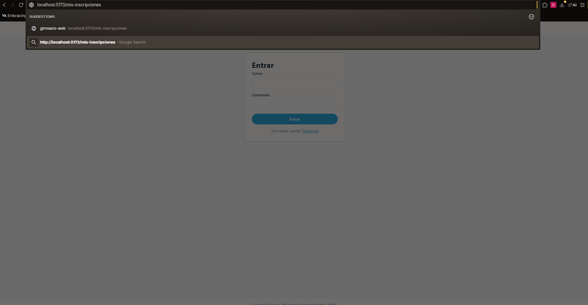
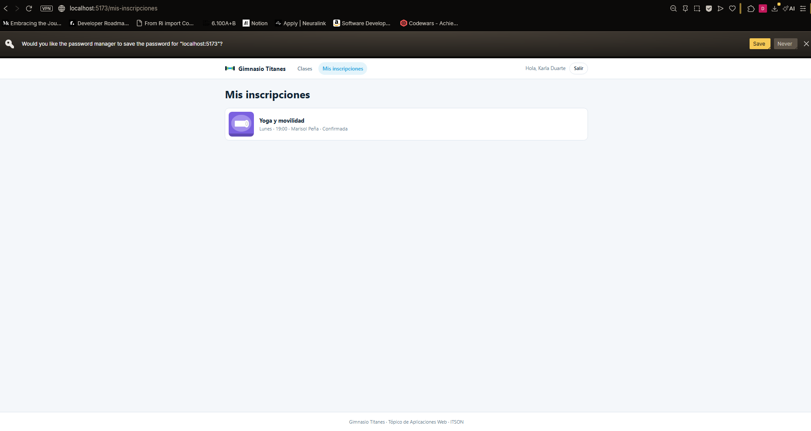
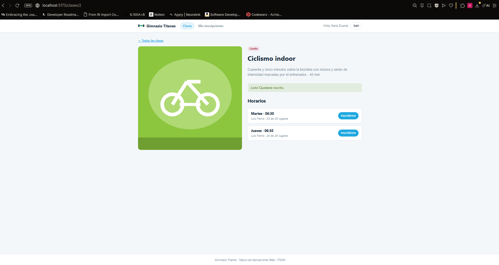
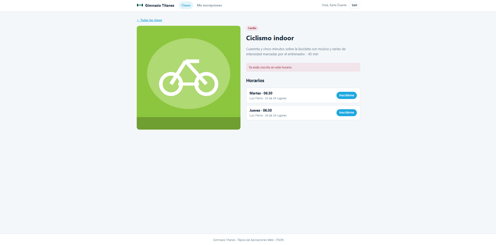
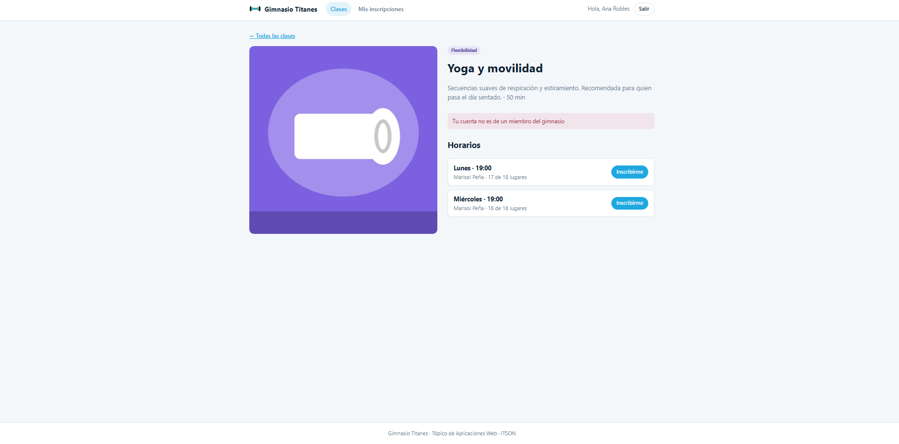
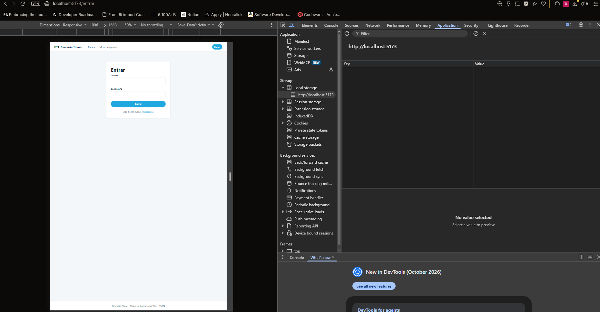

# Práctica 17 – Rutas protegidas, inscripción y 401

## Ejercicio 1: mis inscripciones, sólo con sesión

**¿La ruta protegida hace segura la aplicación? ¿Qué es lo que de verdad protege los datos?**
No. La ruta protegida solo esconde la página en la interfaz; el código del frontend corre en el navegador y cualquiera puede modificarlo o saltarse esa revisión. Lo que de verdad protege los datos es el backend: valida el token en cada petición y responde 401 o 403 si no corresponde.

## Ejercicio 2: inscribirse y el 401

**¿Por qué no se manda el miembroId al inscribirse?**
Porque el cliente podría mandar el id de otra persona e inscribirla. El backend saca al miembro del token, que está firmado y no se puede falsificar, así que solo se envía el horario.

**¿Qué diferencia hay entre un 401 y un 403?**
El 401 significa que no se sabe quién eres (no hay token, es falso o venció). El 403 significa que sí se sabe quién eres, pero tu cuenta no tiene permiso para esa acción.

## Evidencias
**Redirección a /entrar**

**Regreso a la página**

**Inscripción exitosa**

**Error 409**

**Error 403**

**Token falso cerrando la sesión**

