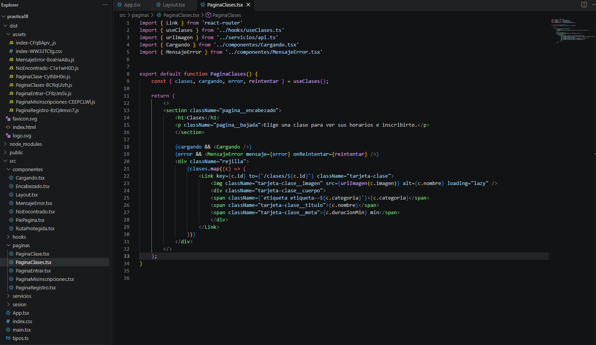
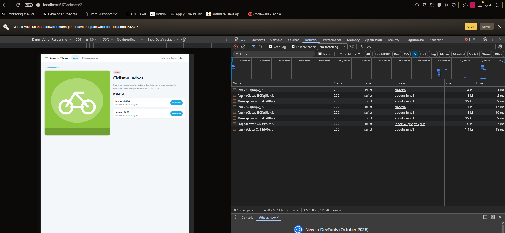
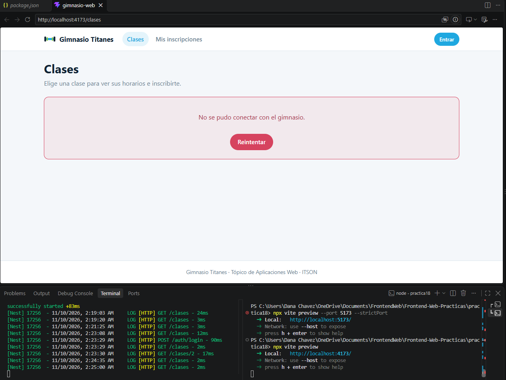
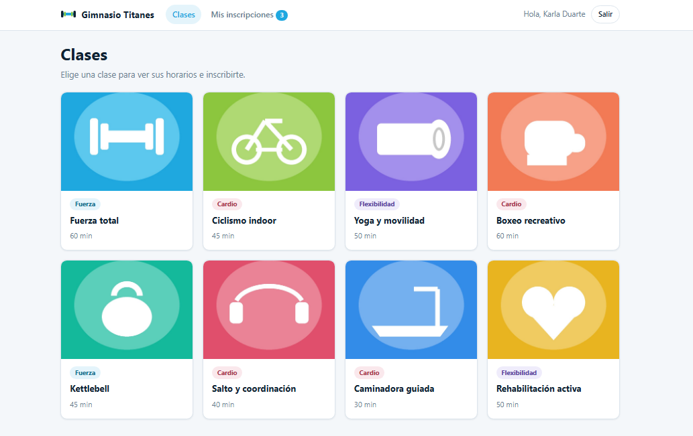
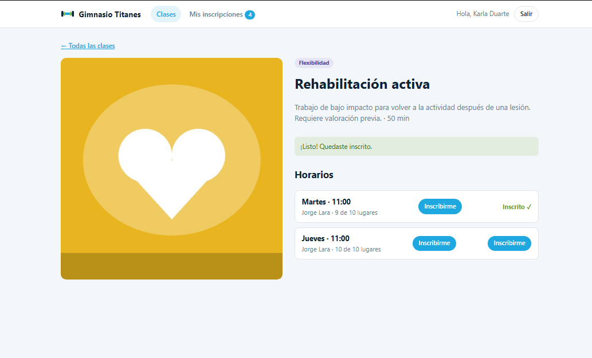

# Práctica 18 – Partir por ruta, carga diferida y store de Zustand

## Ejercicio 1: partir por ruta y medir

### Build antes

Archivos generados con `npm run build` antes de usar `React.lazy`:

- `index.html`: 0.46 kB (gzip 0.29 kB)
- `index-WW33TCtg.css`: 6.43 kB (gzip 1.96 kB)
- `index-DivSvG06.js`: 326.57 kB (gzip 105.44 kB)

### Build después

Archivos generados después de cargar cada página con `React.lazy` y mostrar `Suspense` dentro del layout:

- `index.html`: 0.46 kB (gzip 0.29 kB)
- `index-WW33TCtg.css`: 6.43 kB (gzip 1.96 kB)
- `MensajeError-BKkZtYGO.js`: 0.25 kB (gzip 0.19 kB)
- `NoEncontrado-hI4SOd5v.js`: 0.48 kB (gzip 0.31 kB)
- `PaginaMisInscripciones-Bu2f4NNd.js`: 1.06 kB (gzip 0.50 kB)
- `PaginaEntrar-B5nYulXv.js`: 1.30 kB (gzip 0.62 kB)
- `PaginaClases-Bp3q9nlh.js`: 1.46 kB (gzip 0.70 kB)
- `PaginaRegistro-CDFrT9yr.js`: 1.52 kB (gzip 0.62 kB)
- `PaginaClase-BZA8YIxe.js`: 2.65 kB (gzip 1.13 kB)
- `index-DrYN_M2_.js`: 322.36 kB (gzip 105.12 kB)

### Pestaña Red con `vite preview` en el puerto 5173

Con el build servido en el puerto 5173, al visitar cada página el navegador descarga su archivo JS en ese momento.

### Error de CORS en el puerto 4173

Al correr `vite preview` sin indicar puerto, usa el 4173 y la API falla por CORS.

### Preguntas

**¿Cuánto se ahorró y por qué el ahorro es pequeño en esta aplicación?**
El archivo principal pasó de 326.57 kB a 322.36 kB: se ahorraron unos 4.21 kB, y apenas 0.32 kB comprimido. El ahorro es pequeño porque la aplicación tiene pocas páginas y poco código propio (las siete páginas juntas pesan unos 9 kB). Casi todo el peso son las bibliotecas (React, React Router, Axios), que se necesitan desde el inicio y siguen en el archivo principal.

**¿Por qué falla la API si el preview corre en el puerto 4173?**
Porque `vite preview` usa el puerto 4173 por defecto, y el backend solo permite peticiones (CORS) desde `http://localhost:5173`. El navegador bloquea la respuesta porque ese origen no está autorizado.

---

## Ejercicio 2: un store para las inscripciones

Se creó un store de Zustand (`src/store/useInscripciones.ts`) con las inscripciones, el estado de carga, el error y las funciones `cargar` y `vaciar`.

- Se llena al iniciar sesión (y al recargar con la sesión guardada) y se vacía al presionar Salir.
- El encabezado muestra cuántas inscripciones confirmadas tiene la persona.
- En el detalle de la clase se marcan como inscritos los horarios que ya están en el store.
- Mis inscripciones lee del store en lugar de pedir sus datos.

### Contador del encabezado

Antes de inscribirse:

Después de inscribirse:

### Pregunta

**¿Cuándo conviene un contexto y cuándo un store?**
El contexto conviene para datos que cambian poco y se necesitan en muchas partes, como la sesión: cuando su valor cambia, se vuelven a pintar todos los componentes que lo usan. El store de Zustand conviene para datos que cambian seguido y se comparten entre varias páginas, como las inscripciones: cada componente se suscribe solo a la parte que usa y únicamente se repinta cuando esa parte cambia, además de que no necesita un proveedor.