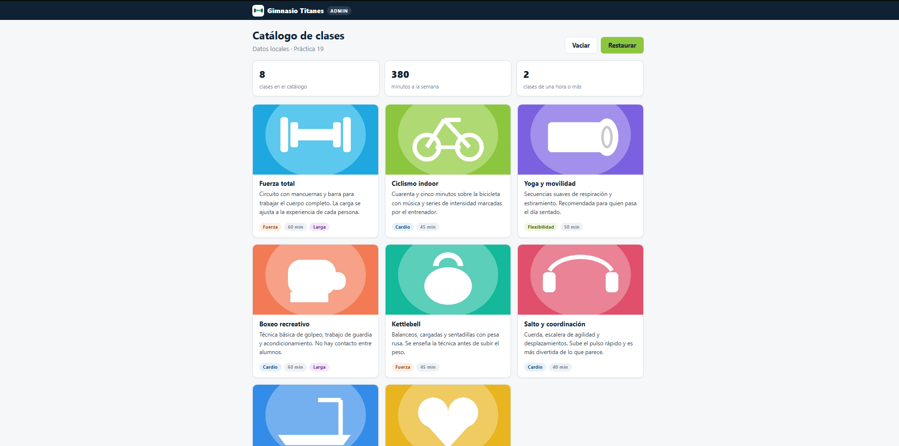
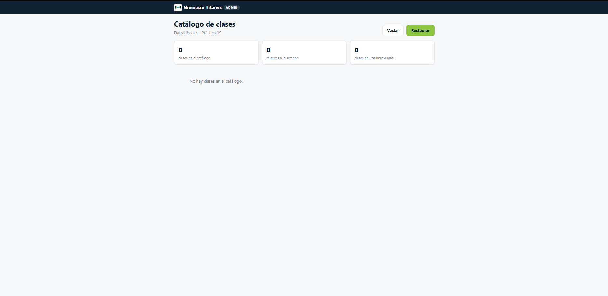
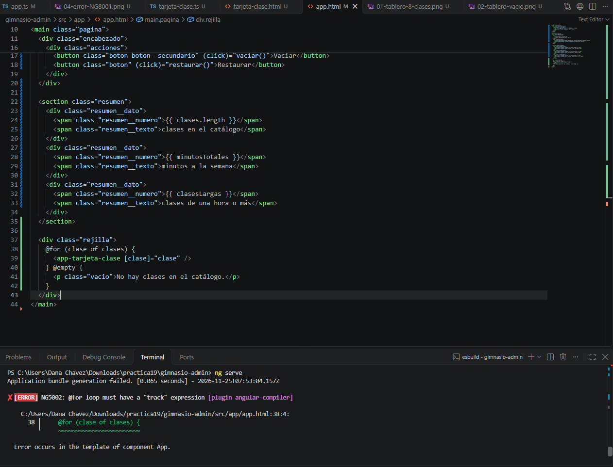
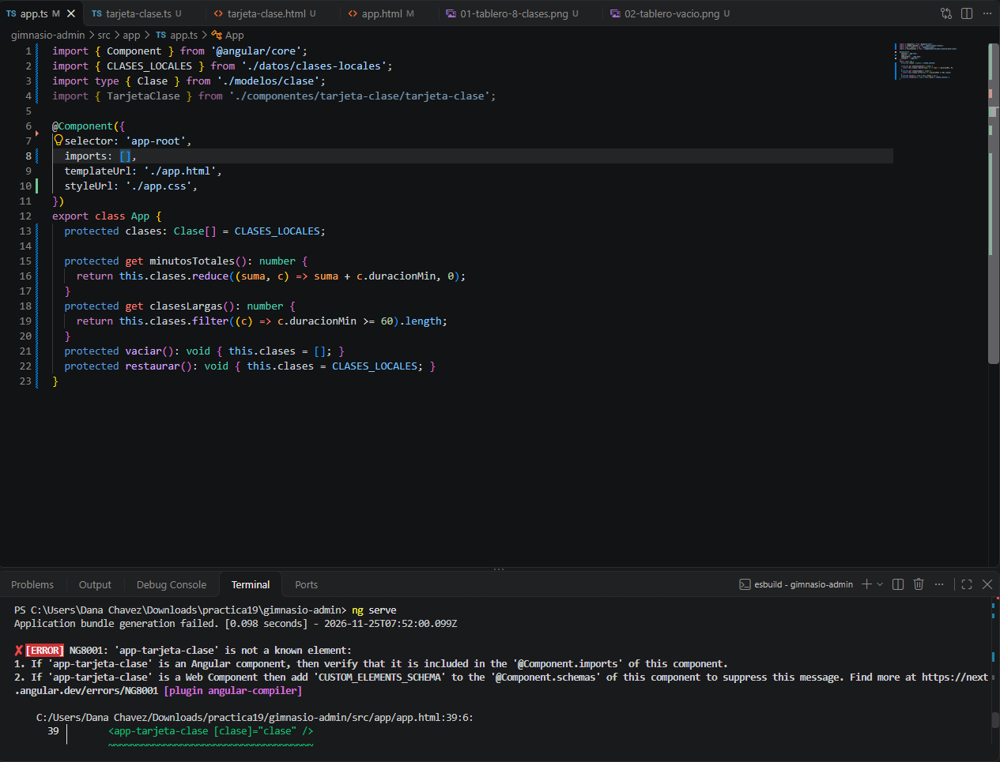

# Práctica 19 – El panel del gimnasio: el tablero en Angular
 
**Alumno:** Dana Chavez
**ID:** 00000249718
 
## Ejercicio 1: el proyecto y el tablero
 
**¿Qué archivo de Angular hace el papel de `main.tsx`, de `App.tsx` y de `vite.config.ts`?**
 
- `main.tsx` === `src/main.ts`: punto de entrada, arranca la aplicación con `bootstrapApplication`.
- `App.tsx` === `src/app/app.ts` (con `app.html`): componente raíz.
- `vite.config.ts` === `angular.json`: configuración del build y del servidor de desarrollo.
## Ejercicio 2: la tarjeta de una clase
 
**¿Por qué `clase()` lleva paréntesis?**
 
Porque `input.required()` devuelve un signal, que es una función. Al llamarla se obtiene el valor actual de la clase y Angular sabe que el template depende de él para actualizarlo cuando cambie. Sin paréntesis se tendría la función, no la clase.
 
**¿Para qué sirve `track`?**
 
Le dice a Angular cómo identificar cada elemento de la lista (aquí `clase.id`). Así, cuando la lista cambia, reutiliza los elementos del DOM que ya existen y solo crea o elimina los necesarios, en vez de repintar todo. `@for` lo exige.
 
**Errores provocados**
 
- **NG8001**: se quitó `TarjetaClase` de `imports` en `app.ts`. Angular no reconoce `<app-tarjeta-clase>`.
- **NG5002**: se quitó `track clase.id` del `@for` en `app.html`.
## Evidencias
 
Tablero con las 8 clases:
 

 
Tablero vacío:
 

 
Error NG5002:
 

 
Error NG8001:
 

 