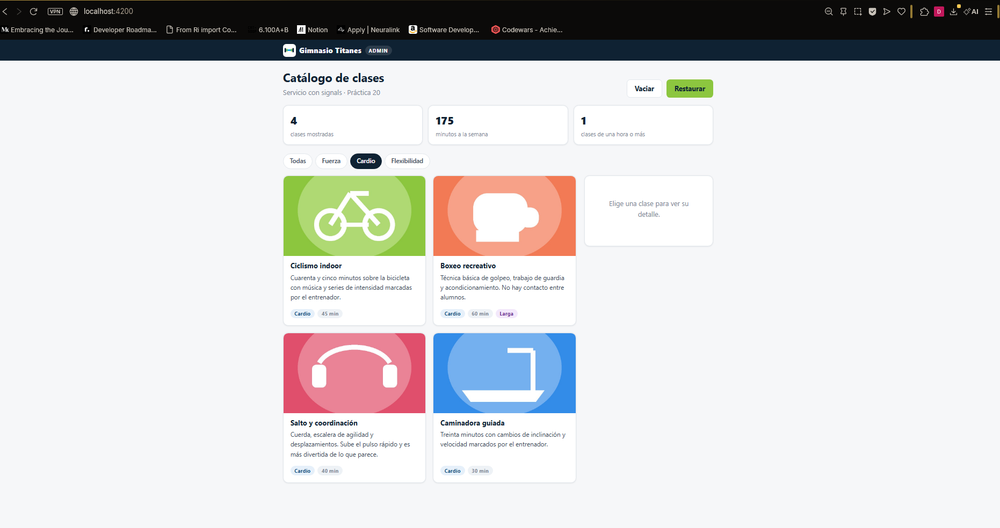
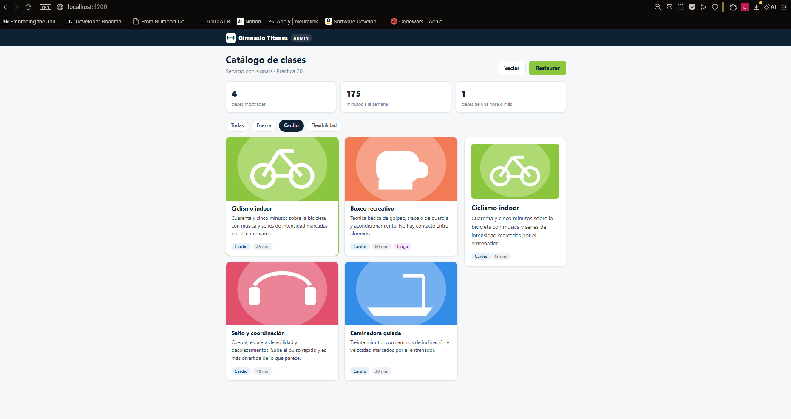
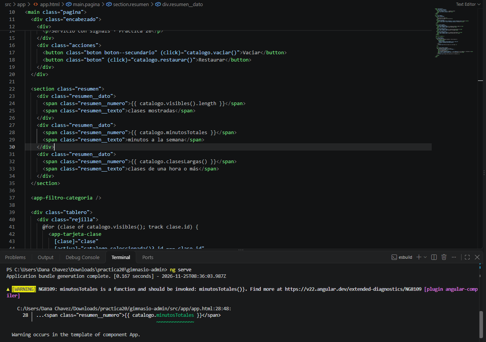

# Práctica 20 – El panel del gimnasio: signals, un servicio y el filtro
 
**Alumno:** Dana Chavez
**ID:** 00000249718
 
## Ejercicio 1: el servicio del catálogo
 
**¿Que diferencia hay entre un signal y un computed, y cuál se parece a useState y cuál a useMemo?**
 
- `signal()` guarda un valor que se puede **escribir** (`set`, `update`). Es el que se parece a `useState`.
- `computed()` **deriva** un valor a partir de otros signals y es de solo lectura. Se recalcula únicamente cuando cambia alguno de los signals que lee y guarda el resultado en memoria. Es el que se parece a `useMemo`, con la ventaja de que Angular detecta solo las dependencias y no hace falta un arreglo de dependencias.
## Ejercicio 2: el filtro y el detalle
 
**¿Que pasa si el filtro hace `new Catalogo()` en lugar de `inject(Catalogo)`?**
 
Se crea una instancia nueva y separada del servicio, en vez de usar la instancia única que Angular comparte con toda la aplicación (`providedIn: 'root'`). Los signals de esa copia son independientes: el filtro cambiaría la categoría en su propia copia y el tablero, que usa la instancia compartida, no se enteraría. Además, `new` se salta la inyección de dependencias de Angular.
 
**Aviso provocado: NG8109**
 
En `app.html` se escribió un signal sin invocarlo dentro de una interpolación (`{{ catalogo.minutosTotales }}` en lugar de `{{ catalogo.minutosTotales() }}`). Angular avisa que el signal debe llamarse como función para leer su valor. Después de la captura se revirtió el cambio.
 
## Evidencias
 
Filtro en Cardio con su resumen:
 

 
Clase elegida con su detalle:
 

 
Aviso NG8109:
 

 