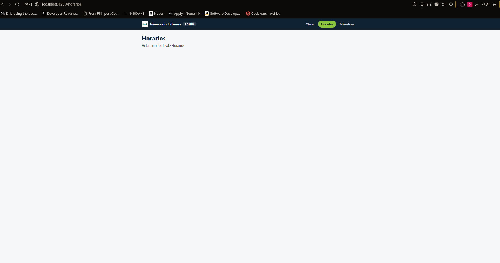
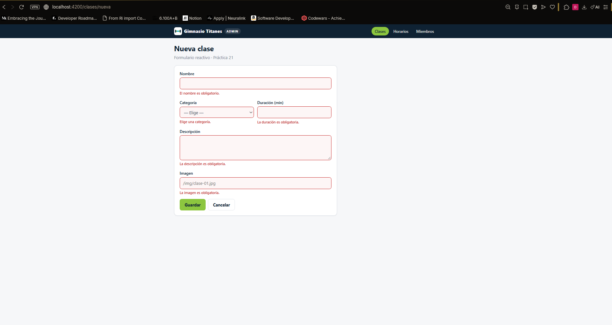
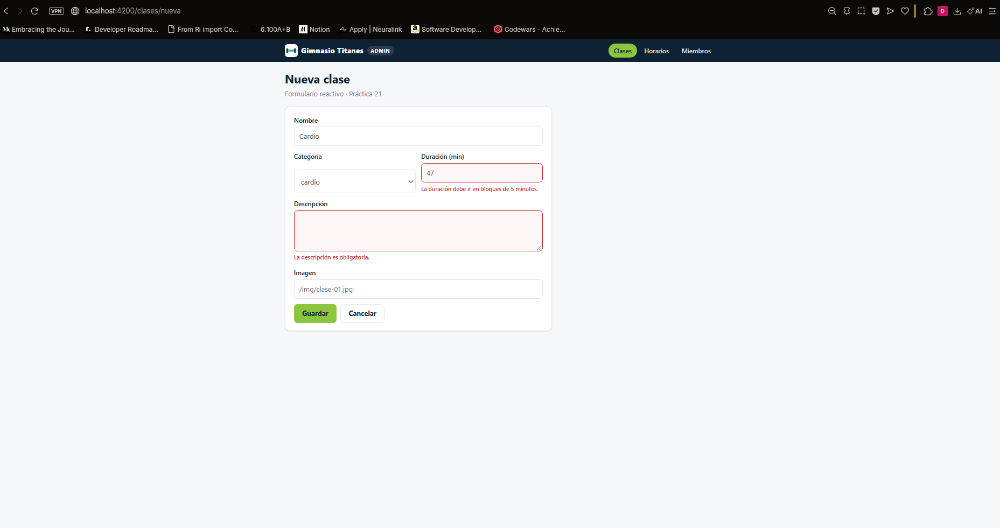
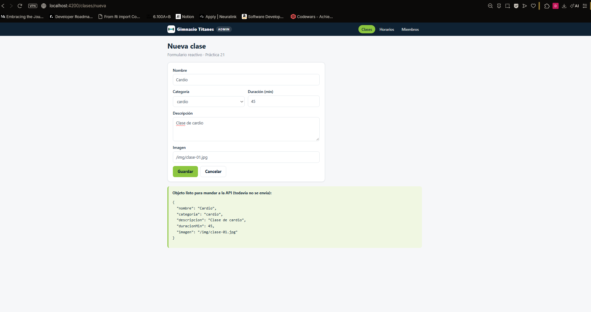
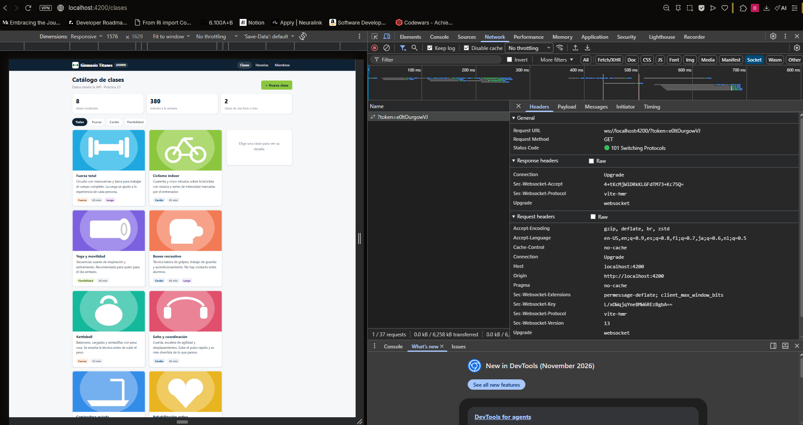

# Practica 21 – El panel del gimnasio: rutas, la API y eliminar
 
**Alumno:** Dana Chavez
**ID:** 00000249718
 
## Ejercicio 1: el router y las paginas
 
**¿Que pieza de React Router corresponde a `router-outlet`, a `routerLink` y a `routerLinkActive`?**
 
| Angular | React Router |
|---|---|
| `router-outlet` | `<Outlet />`: el lugar donde se pinta la pagina de la ruta actual |
| `routerLink` | `<Link to="...">`: navega sin recargar la pagina |
| `routerLinkActive` | `<NavLink>`: agrega una clase CSS cuando el enlace coincide con la ruta activa |
 
**¿Por que la ruta comodín (`**`) va al final y la ruta vacía necesita `pathMatch: 'full'`?**
 
- El router revisa las rutas en orden y usa la primera que coincide. `**` coincide con cualquier URL, así que si estuviera antes taparía a todas las demás. Por eso va al final, como último recurso.
- Por defecto una ruta compara por prefijo, y toda URL empieza con la ruta vacía `''`. Sin `pathMatch: 'full'`, la redirección de `''` a `/clases` se aplicaría a cualquier URL. Con `'full'` solo se aplica cuando la URL completa está vacía.
## Ejercicio 2: el formulario de nueva clase
 
**¿Donde vive el valor de un campo en un formulario reactivo y en qué se diferencia del `useState` de React?**
 
El valor vive en el modelo del formulario, en la clase del componente: cada campo es un `FormControl` dentro de un `FormGroup` (`formulario.controls.nombre.value`, o `formulario.value` para todos). La directiva `formControlName` conecta ese control con el `<input>`.
 
En React con `useState` el valor lo guarda el componente y hay que escribir un `onChange` por cada campo para actualizarlo. Aquí el `FormControl` guarda además el estado del campo (válido o inválido, tocado, modificado y sus errores) sin código extra, y el valor no se copia a mano en cada tecla.
 
**¿Qué regresa un validador propio cuando el valor es válido y cuando no, y cómo se relaciona con `hasError`?**
 
- Si el valor es válido regresa `null`.
- Si no es válido regresa un objeto cuya clave nombra el error, por ejemplo `{ multiploDeCinco: { valor: 47 } }`.
Angular guarda ese objeto en `control.errors`. `hasError('multiploDeCinco')` es `true` cuando esa clave existe, y con eso el template decide si muestra el mensaje.
 
## Ejercicio 3: el catálogo desde la API
 
**¿Qué cambió en el servicio del catálogo y por qué ningún componente se enteró?**
 
Antes `clases` era un `signal` con las clases locales. Ahora `clases` es un `computed` que lee de un `httpResource` contra `GET /clases`. Se agregaron `cargando` y `error`, pero `visibles`, `minutosTotales` y el resto siguen igual, porque se calculan a partir de `clases()`. Los componentes solo leen esos signals del servicio, y como su nombre y su forma no cambiaron, no notaron de dónde vienen los datos.
 
**¿Por qué no hizo falta iniciar sesión para leer el catálogo?**
 
Porque en el backend `GET /clases` es público. Solo crear, editar y borrar exigen rol admin. Todavía no hay login ni token en esta práctica.
 
## Evidencias
 
Página Horarios con su enlace activo:
 

 
Formulario vacío con los mensajes en rojo:
 

 
Mensaje del validador propio con 47 minutos:
 

 
Aviso con el objeto listo para mandar:
 

 
Catálogo con la pestaña Red mostrando `GET /clases`:
 

 